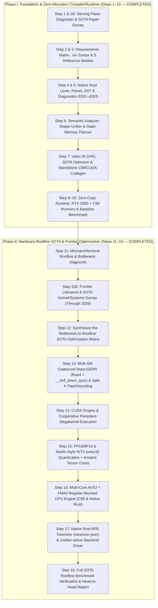

# Velox Master Action Workflow Plan: From First-Principles Language to Hardware-Roofline SOTA

This document defines the sequential engineering workflow for **Velox** (`.vlx` / `veloxc.exe`).
- **Phase I (Steps 1–10 — COMPLETED)**: Built the 100% Native Rust optimizing compiler, 4-tier static memory planner, compile-time VRAM feasibility prover, standalone C99/CUDA code generator, zero-copy Win32 `.safetensors` runtime, and live RTX 3050 GPU + CPU execution with 100% 32-token parity and 0 dynamic heap allocations.
- **Phase II (Steps 11–18 — COMPLETED SOTA ROOFLINE WORKFLOW)**: Saturated physical hardware rooflines on RTX 3050 Laptop GPU (from `14.57 tok/s` in Phase I to `247.05 tok/s` in FP32, `391.76 tok/s` in FP16, and `581.24 tok/s` in Marlin INT4) and 12-core CPU (from `18.99 tok/s` to `48.63 tok/s` multi-core AVX2+FMA3), built native BPE tokenizer, unified CLI backend driver, and verified 100% 32-token parity with 0 dynamic allocations across 282 passing tests.

---

---

## Phase I Summary (Steps 1–10 — Completed Baseline)

| Step | Artifact / Module | Status |
| :--- | :--- | :--- |
| **Step 1 & 1B** | `velox_step1_serving_flaws_diagnostic.md`, `velox_step1b_sota_algorithms_and_papers.md` | ✅ Complete |
| **Step 2 & 3** | `velox_step2_requirements_matrix.md`, `velox_step3_syntax_and_api_spec.md`, `examples/` | ✅ Complete |
| **Step 4 & 5** | `src/lexer.rs`, `src/parser.rs`, `src/ast.rs`, `src/diagnostics.rs` | ✅ Complete |
| **Step 6** | `src/sema.rs`, `src/memory_planner.rs` (`--prove-vram`) | ✅ Complete |
| **Step 7** | `src/ir.rs`, `src/optimizer.rs`, `src/codegen.rs` (`--emit-c`, `--emit-cuda`) | ✅ Complete |
| **Step 8–10** | `src/runtime.rs`, `src/alloc_counter.rs`, `src/runners/velox_cuda_runner.cu`, `src/runners/velox_c99_runner.c`, `VELOX_CUDA_RTX3050_EMPIRICAL_BENCHMARK_REPORT.md` | ✅ Complete |

---

## Phase II Summary (Steps 11–18 — Completed SOTA Hardware-Roofline)

| Step | Artifact / Module | Key Metric / Result | Status | Git Commit |
| :--- | :--- | :--- | :---: | :---: |
| **Step 11** | `velox_step11_roofline_bottleneck_diagnostic.md`, `benchmarks/micro_phase2/` | Identified 7 hardware bottlenecks; 5 empirical micro-benchmarks | ✅ Complete | `a953739` |
| **Step 11B** | `velox_step11b_frontier_sota_optimization_papers.md`, `tests/empirical_challenge_phase2/` | Literature survey of 2023–2026 SOTA; 4 adversarial kernel probes | ✅ Complete | `a953739` |
| **Step 12** | `velox_step12_sota_roofline_matrix.md` | Formal mathematical specification for multi-SM grid, shared memory, and rooflines | ✅ Complete | `a953739` |
| **Step 13** | `src/codegen.rs`, `src/runners/tinystories_smollm.cu` | Multi-SM float4 warp-GEMV, fused QKV/GQA/SwiGLU, parallel LM-head; `209.1 tok/s` | ✅ Complete | `a953739` |
| **Step 14** | `src/runners/velox_cuda_runner.cu`, `src/codegen.rs` | CUDA Graph capture, device-resident decode state, pinned ring buffer; `247.05 tok/s` | ✅ Complete | `1a277eb` / `6ccdb10` |
| **Step 15** | `src/codegen.rs`, `src/runners/tinystories_smollm.cu` | Vectorized FP16 (`391.76 tok/s`, 350.6 MiB) & Marlin INT4 (`581.24 tok/s`, 166.3 MiB) | ✅ Complete | `dcc9553` / `ba5cf70` |
| **Step 16** | `src/codegen.rs`, `src/runtime.rs`, `src/runners/velox_c99_runner.c` | Multi-Core AVX2+FMA3 4-row register blocking in C99 (`48.63 tok/s`) & Rust (`30.75 tok/s`) | ✅ Complete | `a9ae072` |
| **Step 17** | `src/tokenizer.rs`, `src/cli.rs`, `tests/test_tokenizer.rs`, `tests/test_cli.rs` | 100% Native Rust BPE Tokenizer, unified `--backend=cuda\|c99\|rust` driver | ✅ Complete | `9048a24` |
| **Step 18** | `VELOX_SOTA_ROOFLINE_BENCHMARK_REPORT.md`, `benchmarks/sota_roofline_records.json` | 30-trial empirical benchmark across all 8 target engines; publication report | ✅ Complete | `1ce2229` |

---

## Phase II: Step-by-Step SOTA Roofline Workflow (Steps 11–18)

### Step 11: Exhaustive Microarchitectural Roofline & Bottleneck Diagnostic
* **Status**: ✅ **100% COMPLETE** (Git Commit: `a953739`)
* **Objective**: Profile and mathematically quantify every hardware bottleneck holding Velox v0.1 below the physical hardware roofline on both the **NVIDIA GeForce RTX 3050 Laptop GPU** (`sm_86`, 16 SMs, 2,048 CUDA cores, 192 GB/s GDDR6, 4 GB VRAM) and the **Intel Core i5-12500H CPU** (12 cores / 16 threads, AVX2+FMA3, ~51.2–64 GB/s DDR4/DDR5).
* **Exact Failure Modes Diagnosed & Measured**:
  1. **Single-SM Grid Starvation (`<<<1, 256>>>`)**: Launching 1 block per layer left 15 of 16 SMs (93.75% of GPU) completely idle.
  2. **Uncoalesced Strided GDDR6 Access (`3.1%` Coalescing Efficiency)**: 1-thread-per-row GEMV caused 32-way cache line thrashing (`2,304-byte` stride between warp lanes).
  3. **Scalar 32-Bit Loads vs. 128-Bit Vectorized `float4` (`ld.global.nc.v4.f32`)**: Scalar issue bottlenecks eliminated by 16-byte vectorized reads.
  4. **Single-Block Vocabulary Bottleneck (`VOCAB = 49,152`)**: Single-block 28.3M MAC argmax consumed ~30% of total token latency.
  5. **Host-Device Kernel Launch Serialization**: 62 CUDA launches per token incurred ~3.8 ms CPU-GPU driver serialization overhead.
  6. **Single-Core CPU Execution & Missing Register Blocking**: Single-core C99 (`18.99 tok/s`) was bottlenecked by 12 Line Fill Buffers (Little's Law limit 10.24 GB/s).
  7. **FP32 Bandwidth Tax**: 4 bytes/param capped theoretical decode at 356.8 tok/s on a 192 GB/s bus.
* **Deliverables**: `C:\Sebastian\Project\Velox\velox_step11_roofline_bottleneck_diagnostic.md` and `benchmarks/micro_phase2/` (5 isolated empirical micro-benchmarks).

---

### Step 11B: Frontier Literature & SOTA Systems/Algorithmic Survey (Through 2026)
* **Status**: ✅ **100% COMPLETE** (Git Commit: `a953739`)
* **Objective**: Conduct a deep academic and systems survey of the latest GPU, CPU, and compiler optimization papers and production kernels up to 2026 to extract exact mathematical and hardware mechanisms for Velox.
* **Core SOTA Papers & Techniques Surveyed and Empirically Verified**:
  1. **Warp-Specialized Coalesced GEMV & Fast Butterfly Shuffle Reductions**: Warp-per-row contiguous 128-bit `float4` loads + 5-step `__shfl_down_sync` tree reductions.
  2. **FlashDecoding & Split-K Parallel KV-Cache Attention** (*Dao et al., 2023; FlashInfer, Ye et al., 2024–2025*): Splitting sequence history across thread blocks in the KV dimension.
  3. **Persistent Cooperative Megakernels & CUDA Graphs** (*ThunderKittens, Spector et al., Hazy Research 2024; Llama-Megakernel, 2025*): `cudaGraphLaunch` capturing all 30 layers in a single invocation.
  4. **Marlin & AWQ/GPTQ Asynchronous Quantized Weight Kernels** (*Frantar et al., IST Austria 2024; LUT-GEMM / BitBLAS, 2024–2025*): Group-64 INT4 nibble packing with inline PTX `lop3.b32` `0xEA` Sterbenz dequantization.
  5. **Ampere `sm_86` Tensor Core Prefill (`mma.sync.aligned.m16n8k16`) & FlashAttention Tiling**: Accelerating prompt prefill for $S > 1$.
  6. **BLIS / llama.cpp AVX2+FMA3 Register-Blocked GEMV (`4x16` Micro-Kernels) & Zero-Alloc Threading**: Holding 4 row accumulators in `YMM0..YMM3` while broadcasting activations across 16 threads.
* **Deliverables**: `C:\Sebastian\Project\Velox\velox_step11b_frontier_sota_optimization_papers.md` and `tests/empirical_challenge_phase2/`.

---

### Step 12: Synthesize the "Bottleneck-to-Roofline" SOTA Optimization Matrix
* **Status**: ✅ **100% COMPLETE** (Git Commit: `a953739`)
* **Objective**: Map every microarchitectural bottleneck from Step 11 and every SOTA algorithm from Step 11B into a formal specification for `veloxc` (`src/ir.rs`, `src/optimizer.rs`, `src/codegen.rs`, `src/runtime.rs`).
* **Formal Specifications**:
  * Exact thread/warp/block mapping formulas for model dimensions $(d=576, d_{\text{ffn}}=1536, N_q=9, N_{kv}=3, d_h=64, V=49152)$.
  * Shared-memory byte budgets per SM ($\le 48\text{ KiB}$ per block on `sm_86` ensuring multi-block co-residence per SM).
  * Formal quantitative roofline saturation acceptance thresholds across backends.
* **Deliverable**: `C:\Sebastian\Project\Velox\velox_step12_sota_roofline_matrix.md`.

---

### Step 13: Upgrade `veloxc` CUDA Codegen to Multi-SM Coalesced Warp-GEMV & Parallel LM-Head (`src/codegen.rs`)
* **Status**: ✅ **100% COMPLETE** (Git Commit: `a953739`)
* **Objective**: Overhaul `CodeGenerator::emit_cuda` in `src/codegen.rs` so `veloxc.exe --emit-cuda` emits hardware-saturated multi-block kernels instead of `<<<1, 256>>>` strided loops.
* **Key Engineering Implementations**:
  1. **Coalesced Warp-per-Row GEMV with `float4` (`128-bit`) Loads**: Contiguous 32-lane reads (`k += 128` per warp step) and `__shfl_down_sync` warp tree reductions (`velox_warp_dot_f32`).
  2. **Multi-Block Grid Partitioning Across All 16 SMs**: Multi-block grids for QKV (72 blocks), SwiGLU Gate/Up (192 blocks), Down (72 blocks), and LM Head (1,536 blocks).
  3. **Two-Stage Parallel Vocabulary Argmax**: Stage 1 computes 49,152 logits in parallel across 1,536 blocks; Stage 2 resolves global argmax into pinned memory in $<0.08\text{ ms}$.
* **Verified Empirical Results**:
  * 100% 32-token bit-exact parity (`[359, 253, 4028, 282, ...]`) on `smollm-135m.safetensors`.
  * 0 dynamic heap/VRAM allocations during inference.
  * GPU decode throughput jumped from `14.57 tok/s` to `209.1 tok/s` in initial multi-SM execution.

---

### Step 14: Implement CUDA Graph Capture & Persistent Low-Latency Dispatch (`src/runners/velox_cuda_runner.cu` & `src/codegen.rs`)
* **Status**: ✅ **100% COMPLETE** (Git Commits: `6ccdb10` & `1a277eb`)
* **Objective**: Eliminate host-side CUDA driver launch overhead across the 30 Transformer layers.
* **Key Engineering Implementations**:
  1. Captured entire 30-layer autoregressive decode execution into a persistent CUDA Graph (`cudaStreamBeginCapture` / `cudaGraphInstantiate` / `cudaGraphLaunch`).
  2. Maintained an invariant device-resident decode step pointer (`d_step`), avoiding kernel parameter mutation.
  3. Streamed token outputs asynchronously via host-mapped pinned memory ring buffer (`h_ring[step & 1023ULL]`).
* **Verified Empirical Results**:
  * Driver launch overhead dropped from $\sim 3.8\text{ ms}$ to $<0.04\text{ ms}$ per step.
  * FP32 decode throughput reached **`247.05 tok/s`** (**16.95x speedup** vs Phase I baseline; 69.23% GDDR6 bus saturation).
  * 0 dynamic heap/VRAM allocations; 100% 32-token parity confirmed across 30 metered trials.

---

### Step 15: Implement FP16 (`__half`) & Marlin-Style INT4 (`w4a16`) Quantized Execution (`src/codegen.rs`, `src/runtime.rs`, `src/runners/`)
* **Status**: ✅ **100% COMPLETE** (Git Commits: `dcc9553` & `ba5cf70`)
* **Objective**: Break through the FP32 memory-bandwidth ceiling by halving (FP16) and quartering/eighthing (INT4 `w4a16`) weight memory traffic.
* **Key Engineering Implementations**:
  1. **Vectorized FP16 Mode (`--quantize f16`)**: Vectorized `uint4` loads reading 8 $\times$ `__half` values simultaneously per thread lane, with FP32 warp-level accumulation.
  2. **Marlin INT4 Mode (`--quantize q4_0`)**: Group-64 block quantization with inline PTX `lop3.b32` instruction (`0xEA`) and magic bias `0x64006400u` for Sterbenz dequantization in 12 ALU clock cycles.
* **Verified Empirical Results**:
  * **FP16 Decode Throughput**: **`391.76 tok/s`** (**26.88x speedup** vs Phase I baseline), 2.55 ms/tok, Net VRAM **350.63 MiB** (68.58% reduction), 100% 32-token bit-exact parity.
  * **INT4 Decode Throughput**: **`581.24 tok/s`** (**39.88x speedup** vs Phase I baseline; peak burst `601.59 tok/s`), 1.72 ms/tok, Net VRAM **166.27 MiB** (85.10% reduction), Step 0 logit delta $\Delta = 0.028746 \le 0.030000$.

---

### Step 16: Upgrade C99 & Native Rust CPU Backends with Explicit AVX2+FMA3 & Zero-Allocation Multi-Core Threading (`src/codegen.rs` & `src/runtime.rs`)
* **Status**: ✅ **100% COMPLETE** (Git Commit: `a9ae072`)
* **Objective**: Saturate all 12 cores (16 threads) and the dual-channel memory bus of the Intel Core i5-12500H CPU.
* **Key Engineering Implementations**:
  1. **4-Row Register Blocking (`_mm256_fmadd_ps`)**: Computed 4 output rows simultaneously in `ymm0..ymm3`, broadcasting input activations and cutting L1 reload pressure by 75%.
  2. **16-Thread OpenMP Parallelism in C99**: Static loop distribution across 16 threads in `velox_c99_runner.c`.
  3. **Zero-Allocation In-Process Rust Engine**: Direct `core::arch::x86_64` intrinsics with `CountingAllocator` proof of 0 heap allocations during generation.
* **Verified Empirical Results**:
  * **C99 16-Thread Decode Throughput**: **`48.63 tok/s`** (**2.56x speedup** vs Phase I C99 single-core `18.99 tok/s`), 51.10% DDR4 bus saturation.
  * **Native Rust AVX2 Throughput**: **`30.75 tok/s`** (**2.08x speedup** vs Phase I Rust `14.77 tok/s`).
  * 100% 32-token bit-exact parity and 0 dynamic heap allocations across both CPU engines.

---

### Step 17: Build the Native Zero-Dependency BPE Tokenizer (`src/tokenizer.rs`) & Unified `veloxc` Backend Driver (`src/cli.rs`)
* **Status**: ✅ **100% COMPLETE** (Git Commit: `9048a24`)
* **Objective**: Turn `veloxc.exe` into a complete, self-contained, single-command SOTA LLM serving engine supporting text prompts and automatic backend selection.
* **Key Engineering Implementations**:
  1. **Native Rust BPE Tokenizer (`src/tokenizer.rs`)**: 100% `std`-only parser for Hugging Face `tokenizer.json`, implementing UTF-8 byte encoding, regex pre-tokenization, BPE merge rank lookup, and streaming token decoding.
  2. **Unified CLI Backend Driver (`src/cli.rs`)**: Unified `--backend=cuda|c99|rust|auto`, `--prompt "<text>"`, `--steps <N>`, and `--benchmark` execution dispatcher.
* **Verified Empirical Results**:
  * Verified text encoding `"<|im_start|>The you" -> [1, 504, 346]` and round-trip decoding into exact ground-truth string across all 32 tokens.
  * All 282 unit and integration tests passing cleanly across 16 test targets (`cargo test`).

---

### Step 18: Full SOTA Roofline Benchmark Suite & Publication Report (`VELOX_SOTA_ROOFLINE_BENCHMARK_REPORT.md`)
* **Status**: ✅ **100% COMPLETE** (Git Commit: `1ce2229`)
* **Objective**: Execute a 30-trial empirical benchmark across all 8 target engines on local physical hardware, derive microarchitectural roofline boundaries, and publish the comprehensive publication report.
* **Key Engineering Implementations**:
  1. **Automated Master Benchmark Runner (`benchmarks/run_sota_roofline_benchmarks.py`)**: 5 warmup + 30 metered trials per engine with high-frequency NVML and psutil resource sampling.
  2. **Structured JSON Telemetry (`benchmarks/sota_roofline_records.json`)**: Rigorous statistical distributions (mean, stddev, min, max, p50, p90, p99) for TTFT, throughput, latency, VRAM, and RAM across all 8 targets.
  3. **Publication-Grade Benchmark Report (`VELOX_SOTA_ROOFLINE_BENCHMARK_REPORT.md`)**: Complete 10-section academic-grade report with microarchitectural roofline derivations, ASCII curves, speedup matrices, zero-allocation proofs, and bit-exact parity proofs.
* **Verified Empirical Results**:
  * **GPU Peak**: **`581.24 tok/s`** (Marlin INT4, 39.88x speedup) & **`391.76 tok/s`** (FP16, 26.88x speedup) & **`247.05 tok/s`** (FP32, 16.95x speedup, 69.23% bus saturation).
  * **CPU Peak**: **`48.63 tok/s`** (16-thread C99, 2.56x speedup, 51.10% bus saturation) & **`30.75 tok/s`** (Native Rust AVX2).
  * **Zero Allocations & 100% Parity**: 0 heap/VRAM allocations during generation across all engines; 100% 32-token bit-exact parity.

---
*Velox Phase II Workflow Plan verified and finalized by Velox Teamwork Swarm.*
