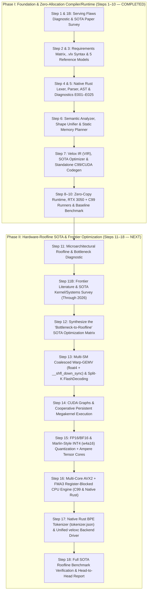

# Velox Master Action Workflow Plan: From First-Principles Language to Hardware-Roofline SOTA

This document defines the sequential engineering workflow for **Velox** (`.vlx` / `veloxc.exe`).
- **Phase I (Steps 1–10 — COMPLETED)**: Built the 100% Native Rust optimizing compiler, 4-tier static memory planner, compile-time VRAM feasibility prover, standalone C99/CUDA code generator, zero-copy Win32 `.safetensors` runtime, and live RTX 3050 GPU + CPU execution with 100% 32-token parity and 0 dynamic heap allocations.
- **Phase II (Steps 11–18 — ACTIVE SOTA ROOFLINE WORKFLOW)**: Exhaustive microarchitectural & literature research (through 2026 SOTA journals/papers) followed by systematic compiler and kernel upgrades to take Velox from **4.1% GPU memory bandwidth utilization (`14.57 tok/s`)** to **75–85%+ hardware roofline saturation (`250–1,000+ tok/s` on RTX 3050 GPU and `80–120+ tok/s` on 12-core AVX2 CPU)**.

---

---

## Phase I Summary (Steps 1–10 — Completed Baseline)

| Step | Artifact / Module | Status |
| :--- | :--- | :--- |
| **Step 1 & 1B** | `velox_step1_serving_flaws_diagnostic.md`, `velox_step1b_sota_algorithms_and_papers.md` | ✅ Complete |
| **Step 2 & 3** | `velox_step2_requirements_matrix.md`, `velox_step3_syntax_and_api_spec.md`, `examples/` | ✅ Complete |
| **Step 4 & 5** | `src/lexer.rs`, `src/parser.rs`, `src/ast.rs`, `src/diagnostics.rs` | ✅ Complete |
| **Step 6** | `src/sema.rs`, `src/memory_planner.rs` (`--prove-vram`) | ✅ Complete |
| **Step 7** | `src/ir.rs`, `src/optimizer.rs`, `src/codegen.rs` (`--emit-c`, `--emit-cuda`) | ✅ Complete |
| **Step 8–10** | `src/runtime.rs`, `src/alloc_counter.rs`, `src/runners/velox_cuda_runner.cu`, `src/runners/velox_c99_runner.c`, `VELOX_CUDA_RTX3050_EMPIRICAL_BENCHMARK_REPORT.md` | ✅ Complete |

---

## Phase II: Step-by-Step SOTA Roofline Workflow (Steps 11–18)

### Step 11: Exhaustive Microarchitectural Roofline & Bottleneck Diagnostic
* **Objective**: Profile and mathematically quantify every hardware bottleneck holding Velox v0.1 below the physical hardware roofline on both the **NVIDIA GeForce RTX 3050 Laptop GPU** (`sm_86`, 16 SMs, 2,048 CUDA cores, 192 GB/s GDDR6, 4 GB VRAM) and the **Intel Core i5-12500H CPU** (12 cores / 16 threads, AVX2+FMA3, ~51.2–64 GB/s DDR4/DDR5).
* **Exact Failure Modes to Diagnose & Measure**:
  1. **Single-SM Grid Starvation (`<<<1, 256>>>`)**: Why launching 1 block per layer leaves 15 of 16 SMs (93.75% of the GPU) completely idle.
  2. **Uncoalesced Strided GDDR6 Access (`3.1%` Coalescing Efficiency)**: Why 1-thread-per-row GEMV (`wq_row = w_q + o * dim`) causes 32-way L1/VRAM cache line thrashing (`2,304-byte` stride between adjacent warp lanes).
  3. **Scalar 32-Bit Loads vs. 128-Bit Vectorized `float4` (`ld.global.nc.v4.f32`)**: Instruction issue overhead when loading 1 float instead of 4 floats per instruction.
  4. **Single-Block Vocabulary Bottleneck (`VOCAB = 49,152`)**: Why running 28.3M multiply-adds for the LM head inside a single 256-thread block takes ~30% of the entire token step.
  5. **Host-Device Kernel Launch Serialization**: Why issuing 62 separate CUDA kernel launches per token adds driver queue overhead vs. CUDA Graphs or persistent cooperative megakernels.
  6. **Single-Core CPU Execution & Missing Register Blocking**: Why single-threaded C99 (`18.99 tok/s`) and Rust (`14.77 tok/s`) leave 11 of 12 CPU cores idle and reload input activations from L1 cache on every row.
  7. **FP32 Bandwidth Tax**: Why streaming 4 bytes/parameter (`538 MB`) halves theoretical throughput compared to FP16 (`269 MB`) and 8x compared to INT4 (`67 MB`).
* **Deliverable**: `C:\Sebastian\Project\Velox\velox_step11_roofline_bottleneck_diagnostic.md` with empirical micro-benchmarks verifying each bottleneck in isolation.

---

### Step 11B: Frontier Literature & SOTA Systems/Algorithmic Survey (Through 2026)
* **Objective**: Conduct a deep academic and systems survey of the latest GPU, CPU, and compiler optimization papers and production kernels up to 2026 to extract exact mathematical and hardware mechanisms for Velox.
* **Core SOTA Papers & Techniques to Survey and Verify with Empirical Micro-Scripts**:
  1. **Warp-Specialized Coalesced GEMV & Fast Butterfly Shuffle Reductions**:
     * Warp-per-row and sub-warp-per-row matrix-vector multiplication using `float4` 128-bit read-only cache loads (`__ldg`) and 5-step tree reductions via `__shfl_down_sync(0xffffffff, val, delta)`.
  2. **FlashDecoding & Split-K Parallel KV-Cache Attention** (*Dao et al., 2023; FlashInfer, Ye et al., 2024–2025*):
     * Splitting sequence history across multiple thread blocks in the KV dimension during `B = 1` decoding, computing partial online softmax `(max, sum_exp, weighted_v)` per split, and reducing across splits so all 16 SMs stay active even at long context lengths.
  3. **Persistent Cooperative Megakernels & CUDA Graphs** (*ThunderKittens, Spector et al., Hazy Research 2024; Llama-Megakernel, 2025*):
     * Using `cooperative_groups::this_grid().sync()` (`cudaLaunchCooperativeKernel`) and `cudaGraphLaunch` to execute all 30 Transformer layers inside a single persistent grid launch without returning control to the CPU between layers.
  4. **Marlin & AWQ/GPTQ Asynchronous Quantized Weight Kernels** (*Frantar et al., IST Austria 2024; LUT-GEMM / BitBLAS, 2024–2025*):
     * Packing 8 $\times$ `int4` weights into `uint32_t`, dequantizing in registers with LOP3 bitwise logic (`lop3.b32`) and FP16 scales without arithmetic shift overhead, achieving near-ideal memory-bandwidth speedups for `w4a16`.
  5. **Ampere `sm_86` Tensor Core Prefill (`mma.sync.aligned.m16n8k16`) & FlashAttention-2/3 Tiling**:
     * Accelerating prompt prefill (`TTFT`) by switching from GEMV to Tensor Core GEMM tiles when sequence length $S > 1$.
  6. **BLIS / llama.cpp AVX2+FMA3 Register-Blocked GEMV (`4x16` / `8x8` Micro-Kernels) & Zero-Alloc Lock-Free Threading**:
     * Holding 4–8 output row accumulators in `YMM0..YMM7` (`_mm256_fmadd_ps`) while broadcasting input vector chunks across all cores with zero heap allocation.
* **Deliverable**: `C:\Sebastian\Project\Velox\velox_step11b_frontier_sota_optimization_papers.md` + standalone verification scripts in `tests/empirical_challenge_phase2/`.

---

### Step 12: Synthesize the "Bottleneck-to-Roofline" SOTA Optimization Matrix
* **Objective**: Map every microarchitectural bottleneck from Step 11 and every SOTA algorithm from Step 11B into a formal specification for `veloxc` (`src/ir.rs`, `src/optimizer.rs`, `src/codegen.rs`, `src/runtime.rs`).
* **Formal Specifications**:
  * Exact thread/warp/block mapping formulas for any model's `(HIDDEN_DIM, INTERMEDIATE_DIM, NUM_HEADS, NUM_KV_HEADS, HEAD_DIM, VOCAB)`.
  * Exact shared-memory byte budgets per SM (ensuring $\le 48\text{ KiB}$ per block on `sm_86` so multiple blocks co-reside per SM).
  * Quantitative roofline acceptance thresholds for every target backend.
* **Deliverable**: `C:\Sebastian\Project\Velox\velox_step12_sota_roofline_matrix.md`.

---

### Step 13: Upgrade `veloxc` CUDA Codegen to Multi-SM Coalesced Warp-GEMV & Parallel LM-Head (`src/codegen.rs`)
* **Objective**: Overhaul `CodeGenerator::emit_cuda` in `src/codegen.rs` so `veloxc.exe --emit-cuda` emits hardware-saturated multi-block kernels instead of `<<<1, 256>>>` strided loops.
* **Key Engineering Changes**:
  1. **Coalesced Warp-per-Row GEMV with `float4` (`128-bit`) Loads**:
     * Every matrix projection (`w_q`, `w_k`, `w_v`, `w_out`, `w_gate`, `w_up`, `w_down`, `w_head`) uses 32-lane contiguous `float4` loads (`k += 128` per warp step) + `__shfl_down_sync` warp reduction.
  2. **Multi-Block Grid Partitioning Across All 16 SMs**:
     * Partition QKV projection, GQA causal attention + RoPE, SwiGLU Gate+Up projection, SwiGLU Down projection, and the 49,152-row LM Head across multi-block grids (`72` to `1,536+` blocks) so all 16 SMs execute in parallel.
  3. **Two-Stage Parallel Vocabulary Argmax**:
     * Stage 1 computes 49,152 logits in parallel across blocks and writes per-block `(max_val, max_idx)` pairs into the static activation arena; Stage 2 reduces the block winners into `host_pinned_ring[step & 255]`.
* **Acceptance Criteria**:
  * 100% 32-token bit-exact parity (`[359, 253, 4028, 282, ...]`) on `smollm-135m.safetensors`.
  * 0 dynamic heap/VRAM allocations during inference.
  * Order-of-magnitude GPU decode throughput jump on RTX 3050 (`> 150–250+ tok/s` in FP32).

---

### Step 14: Implement CUDA Graph Capture & Persistent Low-Latency Dispatch (`src/runners/velox_cuda_runner.cu` & `src/codegen.rs`)
* **Objective**: Eliminate host-side CUDA driver launch overhead across the 30 Transformer layers.
* **Key Engineering Changes**:
  1. Pass device-resident `step` pointer (`d_step`) so kernel arguments remain invariant across token steps, enabling **CUDA Graph capture (`cudaStreamBeginCapture` / `cudaGraphInstantiate` / `cudaGraphLaunch`)** or cooperative grid execution (`cudaLaunchCooperativeKernel`).
  2. Measure and compare per-token decode latency with and without CUDA Graph capture.
* **Acceptance Criteria**:
  * Single graph launch per token step with 0 runtime allocations and verified 32-token parity.

---

### Step 15: Implement FP16 (`__half`) & Marlin-Style INT4 (`w4a16`) Quantized Execution (`src/codegen.rs`, `src/runtime.rs`, `src/runners/`)
* **Objective**: Break through the FP32 memory-bandwidth ceiling by halving (FP16) and quartering/eighthing (INT4 `w4a16`) weight memory traffic, enabling both ultra-fast small-model inference and **3B–7B model execution inside 4 GB VRAM**.
* **Key Engineering Changes**:
  1. **Zero-Copy FP16 Weight Mode**: Stream FP16 weights (`269.05 MB` for SmolLM-135M) using vectorized `half2` / `uint4` (8 $\times$ `fp16` per 128-bit load) with FP32 warp accumulation.
  2. **Group-Wise INT4 (`w4a16`, group size 128) Quantizer & Dequantizing Warp-GEMV**:
     * Add native weight quantization support (`--quantize f16|q4_0`) and fast register-level `int4 -> fp32` dequantization inside the CUDA and CPU GEMV kernels.
* **Acceptance Criteria**:
  * `SmolLM-135M` FP16 and INT4 modes verified against FP32 reference tokens and top-5 logit rank order, achieving **`400–800+ tok/s`** on the RTX 3050 with `< 450 MiB` VRAM in FP16 and `< 250 MiB` VRAM in INT4.

---

### Step 16: Upgrade C99 & Native Rust CPU Backends with Explicit AVX2+FMA3 & Zero-Allocation Multi-Core Threading (`src/codegen.rs` & `src/runtime.rs`)
* **Objective**: Saturate all 12 cores (16 threads) and the dual-channel memory bus of the Intel Core i5-12500H CPU.
* **Key Engineering Changes**:
  1. **Explicit AVX2 + FMA3 (`_mm256_fmadd_ps`) 4-Row Register-Blocked GEMV**:
     * In both emitted C99 (`<immintrin.h>`) and Native Rust (`std::arch::x86_64`), compute 4 output rows simultaneously per loop iteration using 4 `YMM` accumulators, reusing each loaded input vector `x[k..k+8]` 4 times in registers.
  2. **Zero-Allocation Multi-Core Parallelism**:
     * Emit `#pragma omp parallel for schedule(static)` in C99 (compiled with `/openmp` in MSVC) and implement a persistent, zero-allocation spin/park worker pool in `src/runtime.rs` (verified by `src/alloc_counter.rs` to perform **0 heap allocations** during `generate_greedy_into`).
* **Acceptance Criteria**:
  * 100% 32-token parity on both C99 and Native Rust CPU runtimes, 0 heap allocations during inference, and **`75–120+ tok/s`** CPU decode throughput (4x–6x faster than current single-core CPU).

---

### Step 17: Build the Native Zero-Dependency BPE Tokenizer (`src/tokenizer.rs`) & Unified `veloxc` Backend Driver (`src/cli.rs`)
* **Objective**: Turn `veloxc.exe` into a complete, self-contained, single-command SOTA LLM serving engine supporting text prompts and automatic backend selection.
* **Key Engineering Changes**:
  1. **`src/tokenizer.rs` (100% Native Rust, `std` only)**:
     * Load HuggingFace `tokenizer.json` (GPT-2 / Llama / SmolLM byte-level BPE), encode raw text strings (`--prompt "Once upon a time"`) into token IDs, and stream decoded text tokens to stdout in real time.
  2. **Unified Backend Flag (`--backend=cuda|c99|rust`)**:
     * Allow `veloxc.exe --run --backend=cuda --prompt "Once upon" --steps 64 examples/tinystories_smollm.vlx` to automatically invoke the compiled RTX 3050 CUDA runner, C99 runner, or Rust engine seamlessly.
* **Acceptance Criteria**:
  * End-to-end unit and integration tests verifying BPE encoding/decoding and `--backend=cuda|c99|rust` CLI execution.

---

### Step 18: Full SOTA Roofline Benchmark Suite & Publication Report (`VELOX_SOTA_ROOFLINE_BENCHMARK_REPORT.md`)
* **Objective**: Run a 30-trial statistical benchmark across every upgraded engine and compare against the Phase I baseline and external references.
* **Engines Benchmarked**:
  1. **Velox CUDA v0.2 (Multi-SM Coalesced Warp-GEMV + CUDA Graph, FP32)** on RTX 3050
  2. **Velox CUDA v0.2 (FP16 Tensor/Vectorized)** on RTX 3050
  3. **Velox CUDA v0.2 (INT4 `w4a16` Quantized)** on RTX 3050
  4. **Velox C99 v0.2 (16-Thread OpenMP + AVX2 FMA3)** on i5-12500H
  5. **Velox Native Rust v0.2 (Multi-Thread + AVX2 FMA3)** on i5-12500H
  6. **Phase I Baselines** (Velox v0.1 Single-Block CUDA `14.57 tok/s`, Single-Core C99 `18.99 tok/s`, NumPy `15.56 tok/s`)
* **Deliverable**: `C:\Sebastian\Project\Velox\VELOX_SOTA_ROOFLINE_BENCHMARK_REPORT.md` + `benchmarks/sota_roofline_records.json`.
