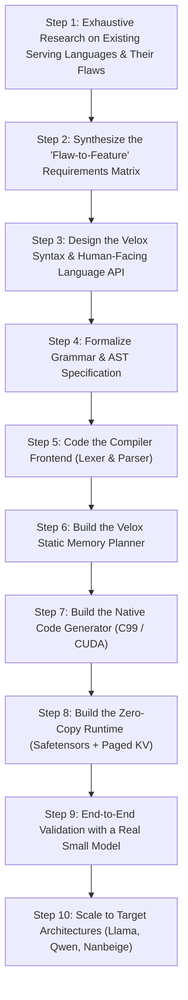

# Velox Step-by-Step Action Workflow Plan

This workflow outlines the exact, sequential actions we will take one by one to create the **Velox** programming language. We start with exhaustive research into every existing language used for LLM serving to catalogue all of their failures and limitations, and systematically build Velox as the direct solution.

---

---

### Step 1: Exhaustive Research on Existing Serving Languages & Frameworks
* We will systematically investigate every language and framework currently used to serve LLMs: **Python** (vLLM, TGI), **C/C++** (llama.cpp, TensorRT-LLM), **Rust** (Candle, Mistral.rs), **Mojo** (Modular MAX), and **CUDA/Triton**.
* For each language, we will document its exact failure points when serving LLMs:
  * Garbage collection pauses and GIL locks (Python).
  * Memory fragmentation during long-running continuous batching (Python/C++).
  * Lack of compile-time VRAM budget and tensor shape safety (C/C++).
  * Borrow checker fights with dynamic graph memory and alias buffers (Rust).
  * Cross-language serialization overhead and FFI boundary penalties (Python-to-C++-to-CUDA).
* **Deliverable**: A comprehensive diagnostic document cataloging every discovered flaw.

---

### Step 2: Build the "Flaw-to-Feature" Requirements Matrix
* For every single flaw identified in Step 1, we will define the exact language rule, compiler check, or memory mechanism Velox will use to eliminate it.
* We will establish the non-negotiable core rules of Velox (e.g., zero dynamic heap allocation during inference, compile-time VRAM verification, $O(1)$ scope-bound data stacks, native paged KV-cache types).
* **Deliverable**: The formal Requirements Specification for Velox.

---

### Step 3: Design the Velox Language Syntax & API
* We will design the syntax of `.vlx` files from a user's perspective, ensuring it is concise, readable, and focused entirely on LLM serving.
* We will define how a developer declares hardware targets, loads model weights, configures the KV-cache, and writes the `prefill` and `decode` execution steps.
* We will write complete reference scripts for standard Transformer models in pure Velox syntax.
* **Deliverable**: The official Velox Syntax Guide and reference `.vlx` code examples.

---

### Step 4: Formalize the Grammar (EBNF) and AST Specification
* We will write the formal Extended Backus-Naur Form (EBNF) grammar that defines every token, statement, expression, and block in Velox.
* We will specify the Abstract Syntax Tree (AST) node structures so the compiler can represent Velox code in memory unambiguously.
* **Deliverable**: The formal Velox Grammar specification.

---

### Step 5: Code the Compiler Frontend (Lexer & Parser)
* We will write the **Lexer** to tokenize `.vlx` source code, tracking line and column numbers for clean error messages.
* We will write the **Parser** (recursive descent) to convert the token stream into the validated AST.
* We will write unit tests to ensure all valid Velox syntax parses cleanly and syntax errors are caught with helpful compiler diagnostics.
* **Deliverable**: A working `veloxc` frontend CLI that ingests `.vlx` files and outputs validated ASTs.

---

### Step 6: Build the Velox Static Memory Planner
* We will build the compiler pass that inspects all tensor operations inside `prefill` and `decode` scopes.
* We will implement the lifetime analyzer that assigns every temporary activation tensor a static byte offset on the contiguous Velox Activation Arena.
* We will implement compile-time VRAM verification: calculating total memory usage $(\text{Weights} + \text{KV-Cache} + \text{Activation Arena})$ and rejecting any program that exceeds the hardware budget before running.
* **Deliverable**: The Velox Static Memory Planner pass inside `veloxc`.

---

### Step 7: Build the Native Code Generator (C99 / CUDA)
* We will build the transpiler backend that translates the validated Velox AST into standalone, high-performance C99 code.
* We will generate vectorized CPU loops (AVX2/FMA) and optional CUDA kernel calls for matrix multiplications and attention.
* We will ensure the generated code has zero calls to `malloc` or `free` during the token generation loop.
* **Deliverable**: A code generator producing single-file, self-contained native C/CUDA files.

---

### Step 8: Build the Minimal Runtime (Safetensors mmap + Paged KV)
* We will build the lightweight C runtime support file that handles:
  1. Memory-mapping (`mmap`) model weights directly from `.safetensors` files without parsing or copying.
  2. The Paged KV-Cache allocator with $O(1)$ page reclamation.
  3. The token sampling logic (greedy, temperature, top-p).
* **Deliverable**: The header/runtime library linked by the generated code.

---

### Step 9: End-to-End Validation with a Real Small Model
* We will download a small open-weight model (e.g., **Stories-15M** or **SmolLM2-135M**) in `.safetensors` format.
* We will write a `.vlx` script for it, compile it with `veloxc`, and compile the resulting C code into an executable.
* We will run the executable, generate real tokens, and verify numerical correctness against Hugging Face reference outputs.
* **Deliverable**: A working, standalone executable generating text from a real model with zero dynamic allocations.

---

### Step 10: Scale to Target Architectures & Benchmarking
* We will write `.vlx` model definitions for larger architectures (e.g., Qwen2.5, Llama-3, and Nanbeige-family).
* We will benchmark token generation speed, latency, and memory stability against existing engines (`llama.cpp` and `vLLM`).
* We will document the complete guide on how to serve any model with Velox.
* **Deliverable**: Performance benchmark report and documentation.
